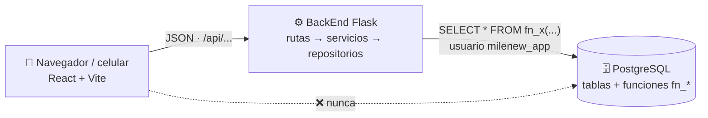

# 🚍 Milenew — TransMilenio en tu bolsillo

[](https://github.com/wilmer300419/Milenew_FrontEnd/actions/workflows/ci.yml)

Aplicación web que emula la operación de **TransMilenio** (Troncal Caracas y Troncal Autopista Norte) con tres
tipos de usuario: **pasajero**, **operador** (conductor) y **central de operaciones**.

- **FrontEnd:** React 18 + Vite (aplicación web instalable, PWA).
- **BackEnd:** API REST en Flask.
- **Base de datos:** PostgreSQL. Toda la lógica de datos vive en funciones almacenadas `fn_*`.

> **Regla de oro:** el navegador **nunca** habla con la base de datos. El FrontEnd solo llama a `/api/...`.
> El BackEnd solo ejecuta funciones `fn_*`, con un usuario de PostgreSQL que no puede leer tablas directamente.

---

## 📑 Índice

1. [Qué hace la app](#-qué-hace-la-app)
2. [Equipo](#-equipo)
3. [Arquitectura](#️-arquitectura)
4. [Tecnologías](#-tecnologías)
5. [Requisitos](#-requisitos)
6. [Arranque rápido (la primera vez)](#-arranque-rápido-la-primera-vez)
7. [Arranque diario](#-arranque-diario)
8. [Todo con Docker](#-todo-con-docker)
9. [Abrir la app desde el celular](#-abrir-la-app-desde-el-celular)
10. [Usuarios de prueba y recorrido guiado](#-usuarios-de-prueba-y-recorrido-guiado)
11. [Estructura del repositorio](#-estructura-del-repositorio)
12. [Variables de entorno](#-variables-de-entorno)
13. [Base de datos](#️-base-de-datos)
14. [API](#-api)
15. [Seguridad](#️-seguridad)
16. [Pruebas](#-pruebas)
17. [Comandos útiles del BackEnd](#️-comandos-útiles-del-backend)
18. [Cómo trabajamos con Git](#-cómo-trabajamos-con-git)
19. [Integración continua (CI)](#-integración-continua-ci)
20. [Solución de problemas](#-solución-de-problemas)
21. [Limitaciones conocidas](#️-limitaciones-conocidas)

---

## ✨ Qué hace la app

### 👤 Pasajero (`/app`)

| Sección | Qué puede hacer |
| --- | --- |
| **Inicio** | Ver su viaje en curso con la llegada estimada, el saldo de TuLlave, sus últimos viajes, avisos y las próximas llegadas a sus estaciones. Planear un viaje. |
| **En vivo** | Ver los buses moviéndose sobre la troncal (línea y mapa de OpenStreetMap), cambiar de troncal y consultar las llegadas de cada estación. Reportar incidencias. |
| **Viajes** | Planear un viaje: elige expreso o corriente según el tiempo y cobra el pasaje de la tarjeta. Ver el historial y las estaciones favoritas. |
| **TuLlave** | Recargar la tarjeta (con confirmación) y ver todos los movimientos. |
| **Perfil** | Editar sus datos, cambiar la contraseña, elegir tema claro u oscuro, configurar notificaciones, cerrar sesión en todos los dispositivos y eliminar la cuenta. |

### 🚍 Operador (`/operador`)

| Tarjeta | Qué hace |
| --- | --- |
| **Bus en vivo** | Estación actual y siguiente, velocidad, aforo, recorrido y próximas paradas con su tiempo. |
| **Turno** | Se puede iniciar solo con un bus asignado y el **checklist pre-operacional completo**. Muestra un cronómetro del tiempo conducido y permite tomar pausas. Avisa tras 4 h de conducción continua. Al cerrar, guarda un resumen: paradas, km, vueltas, pasajeros y puntualidad. |
| **SOS** | Se mantiene presionado **2 segundos** para alertar a la central; funciona con mouse, dedo o teclado. Llega con el bus y la ubicación. |
| **Intervalo** | Cuántos minutos lleva de ventaja el bus de adelante y de atrás (mismo servicio), y si va *adelantado*, *a tiempo* o *atrasado*, con una recomendación. |
| **Novedades** | Reportar falla mecánica, accidente, emergencia médica, etc., y ver si la central ya las atendió. |
| **Avisos de la central** | Desvíos y cierres publicados por la central. El operador los confirma con **"Enterado"**. |
| **Puertas, ocupación y checklist** | Las puertas se bloquean si el bus está en movimiento. Ocupación por vagón. Checklist del día. |
| **Chat** | Mensajes en tiempo real con la central, con respuestas rápidas. |

### 🛡️ Central de operaciones (`/central`)

| Sección | Qué hace |
| --- | --- |
| **Resumen** | Indicadores (KPI), **alerta roja cuando un operador activa SOS** y bandeja de incidencias. Una incidencia se puede atender o cerrar con una nota, que le llega como aviso a quien la reportó. Troncal en vivo. |
| **Mensajes** | Conversaciones con cada operador, con contador de mensajes sin leer. |
| **Flota** | Asignar buses a operadores (un bus por operador) y ver quién está en turno o en pausa. Publicar avisos **para todos** o **solo para operadores** y ver cuántos los confirmaron. |

### 🌐 Público

Landing, registro con aceptación de la política de datos (Ley 1581 de 2012), inicio de sesión con reCAPTCHA,
recuperación de cuenta con un código enviado al correo, política de privacidad y términos.

---

## 👥 Equipo

### 🗄️ Base de datos

| Integrante | Correo |
| --- | --- |
| Wilmer Andrés Capera Hernández | [wilmerandres3004@gmail.com](mailto:wilmerandres3004@gmail.com) |
| Esteban Salvador | [windishowlingf@gmail.com](mailto:windishowlingf@gmail.com) |
| Héctor Fabián Ruiz Ordoñez | [ruizfabian2003@gmail.com](mailto:ruizfabian2003@gmail.com) |
| Sebastian Restrepo | [bastianrtl@gmail.com](mailto:bastianrtl@gmail.com) |

### ⚙️ BackEnd

| Integrante | Correo |
| --- | --- |
| Angel David Peña Sanchez | [superoofio60.p@gmail.com](mailto:superoofio60.p@gmail.com) |
| Pablo Rodríguez | [huevito1009@hotmail.com](mailto:huevito1009@hotmail.com) |
| Gylmar Rodriguez | [gylmara1981@gmail.com](mailto:gylmara1981@gmail.com) |
| Fray Nicolás Minganquer | [fraynicming@gmail.com](mailto:fraynicming@gmail.com) |

### 🎨 FrontEnd

| Integrante | Correo |
| --- | --- |
| Joan Sebastian Romaña Tavera | [Joansebastianromanatavera@gmail.com](mailto:Joansebastianromanatavera@gmail.com) |
| Santiago Santana | [santiagosantananieto2@gmail.com](mailto:santiagosantananieto2@gmail.com) |
| Juan Jose Lopez Reina | [Juan1909070@gmail.com](mailto:Juan1909070@gmail.com) |
| Daniel Chaves Muñoz | [decosmos.dan@gmail.com](mailto:decosmos.dan@gmail.com) |
| Andres Felipe Dueñas Martinez | [andresfelipeduenasmartinez10@gmail.com](mailto:andresfelipeduenasmartinez10@gmail.com) |

---

## 🏗️ Arquitectura



Cada petición sigue siempre el mismo camino:

```text
Navegador ─► src/services/*.js              (axios, siempre a /api)
          ─► backend/app/routes/*.py        (HTTP: recibe y responde JSON)
          ─► backend/app/services/*.py      (validación y reglas de negocio)
          ─► backend/app/repositories/*.py  (solo llaman call_function("fn_..."))
          ─► database/functions/*.sql       (la única puerta a las tablas)
```

- En **desarrollo**, Vite (puerto 5173) reenvía `/api` al BackEnd (puerto 5000), así que no hace falta configurar CORS.
- En **producción (Docker)**, nginx sirve la app y reenvía `/api` a gunicorn. La base de datos no expone puertos.
- La sesión viaja en una **cookie httpOnly**: el JavaScript de la página no puede leer el token.

---

## 🧰 Tecnologías

| Capa | Herramientas |
| --- | --- |
| FrontEnd | React 18, React Router 6, Vite 5, Framer Motion, Lucide (íconos), Leaflet + OpenStreetMap, Axios, fuentes autoalojadas (Inter, JetBrains Mono) |
| BackEnd | Python 3.12, Flask 3, PyJWT, psycopg 3 + pool de conexiones, Flask-Limiter (con Redis en producción), gunicorn |
| Base de datos | PostgreSQL 16 o superior (probado también con 18) |
| Pruebas | Vitest + Testing Library, pytest, Playwright + axe-core (accesibilidad) |
| Despliegue | Docker Compose: postgres, redis, api y web (nginx con CSP) |
| Calidad | ESLint, GitHub Actions, Dependabot |

---

## 📋 Requisitos

| Programa | Versión | Comprobar |
| --- | --- | --- |
| Git | cualquiera reciente | `git --version` |
| Node.js | **20 o superior** (CI usa 22) | `node -v` |
| Python | **3.11 o superior** (CI usa 3.12) | `python3 --version` |
| PostgreSQL | **16 o superior**, con `psql` | `psql --version` |
| Docker *(opcional)* | con Compose v2 | `docker compose version` |

> En Windows, usa `python` en vez de `python3` y activa el entorno virtual con `venv\Scripts\activate`.
> Si `psql` "no se reconoce", agrega `C:\Program Files\PostgreSQL\<versión>\bin` al PATH.

---

## 🚀 Arranque rápido (la primera vez)

Necesitas **dos terminales**: una para el BackEnd y otra para el FrontEnd. La base de datos es tu PostgreSQL local.

### 0. Clonar

```bash
git clone https://github.com/wilmer300419/Milenew_FrontEnd.git
cd Milenew_FrontEnd
git checkout develop        # rama de integración (o la rama en la que trabajes)
```

### 1. Base de datos

```bash
# Crea la base "milenew" (pide la contraseña del usuario postgres)
psql -h localhost -U postgres -f database/scripts/00_create_database.sql

# Crea tablas, funciones y datos iniciales (troncales, estaciones, buses, checklist)
psql -h localhost -U postgres -d milenew -f database/scripts/01_init.sql

# (Recomendado) Usuario con permisos mínimos para el BackEnd: solo puede ejecutar funciones fn_*
psql -h localhost -U postgres -d milenew -v app_password="'cambia_esto'" -f database/scripts/02_app_role.sql
```

> `01_init.sql` es **idempotente**: se puede correr cuantas veces quieras. Vuelve a correrlo cada vez que bajes
> cambios que toquen `database/`. Así actualiza tu base sin borrar tus datos.

### 2. BackEnd (terminal 1)

```bash
cd backend
python3 -m venv venv
source venv/bin/activate                 # Windows: venv\Scripts\activate
pip install -r requirements.txt
cp .env.example .env                     # Windows: copy .env.example .env
```

Abre `backend/.env` y completa al menos esto:

```dotenv
SECRET_KEY=<pega aquí el resultado de: python3 -c "import secrets; print(secrets.token_hex(32))">
DATABASE_USER=milenew_app                # o postgres, si no creaste el rol del paso 1
DATABASE_PASSWORD=cambia_esto            # la contraseña que pusiste en el paso 1
```

Luego:

```bash
flask seed-demo-users    # crea los 3 usuarios de prueba y le asigna un bus al conductor
flask run                # → http://localhost:5000/api/health  debe responder "database": "ok"
```

### 3. FrontEnd (terminal 2, en la raíz del repositorio)

```bash
cp .env.example .env     # ya viene listo para desarrollo
npm install
npm run dev              # → http://localhost:5173
```

Abre **http://localhost:5173** y entra con uno de los [usuarios de prueba](#-usuarios-de-prueba-y-recorrido-guiado).

---

## 🔁 Arranque diario

Después de la primera vez, basta con esto:

```bash
# Terminal 1 · BackEnd
cd Milenew_FrontEnd/backend
source venv/bin/activate          # Windows: venv\Scripts\activate
flask run
```

```bash
# Terminal 2 · FrontEnd
cd Milenew_FrontEnd
npm run dev
```

**Si bajaste cambios nuevos** (`git pull`), antes de arrancar corre lo que corresponda:

| Si cambió… | Corre |
| --- | --- |
| `database/` | `psql -h localhost -U postgres -d milenew -f database/scripts/01_init.sql`, y si usas `milenew_app`, también el `02_app_role.sql` del paso 1, para que tenga permiso sobre las funciones nuevas |
| `backend/requirements.txt` | `pip install -r requirements.txt` (con el venv activo) |
| `package.json` | `npm install` |

Para apagar todo, presiona `Ctrl + C` en cada terminal.

---

## 🐳 Todo con Docker

Levanta PostgreSQL, Redis, la API y la web con un solo comando. No necesitas Python, Node ni PostgreSQL instalados.

```bash
cp deploy/.env.example deploy/.env
# Edita deploy/.env: POSTGRES_PASSWORD, APP_DB_PASSWORD y SECRET_KEY (solo letras y números)
docker compose --env-file deploy/.env up --build
```

Abre **http://localhost:8080**. Con `SEED_DEMO_USERS=true` se crean los usuarios de prueba.

| Comando | Para qué |
| --- | --- |
| `docker compose --env-file deploy/.env up -d --build` | Arrancar en segundo plano |
| `docker compose logs -f api` | Ver los logs de la API (ahí salen los códigos de correo si no hay SMTP) |
| `docker compose down` | Apagar (conserva la base) |
| `docker compose down -v` | Apagar **y borrar** la base de datos |

---

## 📱 Abrir la app desde el celular

1. Conecta el celular **al mismo WiFi** que el computador. Con datos móviles no funciona.
2. Arranca el FrontEnd así:
   ```bash
   npm run dev -- --host
   ```
3. Vite muestra una línea como `Network: http://192.168.1.25:5173`. Abre **esa dirección** en el celular.
4. Si no carga, abre el puerto 5173 en el firewall del computador:
   - **Fedora / Nobara:** `sudo firewall-cmd --add-port=5173/tcp` (dura hasta reiniciar).
   - **Ubuntu:** `sudo ufw allow 5173/tcp`.
   - **Windows:** acepta el aviso del firewall para Node.js en "Redes privadas".

El BackEnd no se toca: el celular solo habla con Vite, y Vite reenvía `/api` a Flask en tu computador.

---

## 🧪 Usuarios de prueba y recorrido guiado

Se crean con `flask seed-demo-users`:

| Rol | Correo | Contraseña | Entra a |
| --- | --- | --- | --- |
| Pasajero | `pasajero@milenew.co` | `Pasajero123` | `/app` |
| Operador | `conductor@milenew.co` | `Conductor123` | `/operador` (bus B75 · 7042) |
| Central | `central@milenew.co` | `Central123` | `/central` |

> Para ver dos roles al mismo tiempo, usa una ventana normal y otra **de incógnito**, porque cada una tiene su
> propia sesión.

**Recorrido sugerido (5 minutos):**

1. **Pasajero:** recarga la TuLlave, planea un viaje (Calle 76 → Calle 57), págalo y mira el viaje en curso en el inicio.
   En **En vivo**, reporta una incidencia.
2. **Operador:** completa el checklist e **inicia turno**. Revisa el intervalo, mantén presionado **SOS** 2 segundos
   y escribe a la central.
3. **Central:** aparece la **alerta de SOS**. Ciérrala con una nota. Responde el chat. En **Flota**, publica un aviso
   *Solo operadores*.
4. **Operador:** ve la nota de la central en *Novedades*, pulsa **Enterado** en el aviso y **termina el turno**
   para ver el resumen.
5. **Pasajero:** en la campana 🔔 aparece "Tu reporte fue atendido".

---

## 📁 Estructura del repositorio

```text
.
├── src/                          FrontEnd (React)
│   ├── pages/                    Una carpeta por zona: auth, passenger, operator, central, legal
│   ├── components/
│   │   ├── ui/                   Piezas base: Glass, Button, Field, Modal, ConfirmDialog, Segmented…
│   │   ├── transit-ui/           Troncal: RouteLine, TransitMap, Arrivals, StationPicker, BusCard…
│   │   ├── operator/             Turno, SOS, intervalo, novedades y avisos del operador
│   │   ├── layout/               AppShell (menú), notificaciones, banner de conexión
│   │   ├── auth/                 reCAPTCHA con el estilo de la app
│   │   └── background/           Fondo de vidrio que revela Bogotá bajo la luz del cursor
│   ├── services/                 ÚNICO lugar que llama a la API (axios → /api)
│   ├── context/                  Sesión, tema, preferencias, viaje activo, notificaciones, toasts
│   ├── hooks/                    usePolling, useTransit, useNow, useMediaQuery
│   ├── routes/AppRoutes.jsx      Rutas y protección por rol
│   ├── styles/                   tokens.css (colores y medidas), glass, layout, transit
│   └── test/                     Pruebas de componentes (Vitest)
├── public/                       manifest, service worker (sw.js), íconos
├── e2e/                          Pruebas de punta a punta (Playwright) + auditoría de accesibilidad
├── backend/
│   ├── app/routes/               Endpoints HTTP (auth, users, transit, wallet, trips, admin, notifications, health)
│   ├── app/services/             Validación y reglas de negocio (incluye la simulación de buses)
│   ├── app/repositories/         Llamadas a funciones fn_* (nada de SQL suelto)
│   ├── app/utils/                Sesión/JWT, errores, respuestas JSON, captcha, validación
│   ├── app/cli.py                Comandos: seed-demo-users, create-user, assign-bus
│   ├── tests/                    unit/ (sin BD) e integration/ (BD temporal real)
│   ├── gunicorn.conf.py          Servidor de producción
│   └── Dockerfile
├── database/
│   ├── tables/                   CREATE TABLE … IF NOT EXISTS (+ ALTER idempotentes)
│   ├── functions/                Funciones fn_* (la API de la base de datos)
│   ├── scripts/                  00 crear BD · 01 init · 02 rol mínimo · 03 datos · 99 borrar BD
│   └── docker/initdb.sh          Inicialización automática en Docker
├── deploy/                       nginx.conf (CSP, caché, proxy) y .env.example de producción
├── docs/API.md                   Contrato completo de la API (endpoints, JSON, códigos)
├── docs/github-setup.md          Configuración única del repositorio en GitHub
├── CONTRIBUTING.md               Cómo trabajar: ramas, commits, PR
├── docker-compose.yml
└── .github/                      CI, plantillas de issues y PR, Dependabot
```

---

## 🔐 Variables de entorno

Nunca subas archivos `.env` al repositorio (ya están en `.gitignore`). Solo se versionan los `.env.example`.

### FrontEnd — `.env` (raíz)

| Variable | Ejemplo | Para qué |
| --- | --- | --- |
| `VITE_API_URL` | `/api` | URL base de la API. En desarrollo, `/api` (Vite la reenvía al BackEnd). |
| `BACKEND_URL` | `http://localhost:5000` | Adónde reenvía Vite `/api`. No llega al navegador. |
| `VITE_RECAPTCHA_SITE_KEY` | clave de prueba de Google | reCAPTCHA v2 **invisible**. La clave de ejemplo es de prueba y siempre aprueba. |
| `VITE_CONTACT_EMAIL` | *(vacío)* | Correo de contacto que aparece en la política de datos. |

> ⚠️ Todo lo que empieza con `VITE_` queda **público** dentro del JavaScript. Nunca pongas ahí contraseñas.

### BackEnd — `backend/.env`

| Variable | Por defecto | Para qué |
| --- | --- | --- |
| `SECRET_KEY` | **obligatoria** | Firma las sesiones. Genera una con `python3 -c "import secrets; print(secrets.token_hex(32))"`. |
| `DATABASE_HOST` / `DATABASE_PORT` / `DATABASE_NAME` | `localhost` / `5432` / `milenew` | Conexión a PostgreSQL. |
| `DATABASE_USER` / `DATABASE_PASSWORD` | — | Usuario de la base. Lo recomendado es `milenew_app`. |
| `DB_POOL_ENABLED` / `DB_POOL_MAX` | `true` / `10` | Pool de conexiones. |
| `JWT_EXPIRES_MINUTES` | `60` | Duración de la sesión normal. |
| `REMEMBER_DAYS` | `30` | Duración con "Recordar mis datos". |
| `AUTH_COOKIE_SECURE` | `false` | Ponlo en `true` en producción con HTTPS. |
| `AUTH_COOKIE_SAMESITE` | `Lax` | `None` solo si el FrontEnd está en otro dominio (requiere `Secure`). |
| `CORS_ORIGINS` | `http://localhost:5173` | Orígenes permitidos, separados por comas. |
| `RATELIMIT_ENABLED` / `RATELIMIT_STORAGE_URI` | `true` / `memory://` | Límite de intentos. Con varios workers usa `redis://…`. |
| `TRUST_PROXY` | `false` | `true` detrás de nginx (para leer la IP real). |
| `RECAPTCHA_SECRET_KEY` | clave de prueba | Secreto del captcha. **Vacío = no se valida** (solo para desarrollo). |
| `TWO_FACTOR_ENABLED` | `false` | Verificación en dos pasos por correo al iniciar sesión. |
| `MAIL_SERVER`, `MAIL_PORT`, `MAIL_USE_TLS`, `MAIL_USERNAME`, `MAIL_PASSWORD`, `MAIL_FROM` | vacío | SMTP. Si `MAIL_SERVER` está vacío, los códigos se **imprimen en la consola de Flask**. |
| `AUTH_CODE_TTL_MINUTES` / `AUTH_CODE_MAX_ATTEMPTS` | `10` / `5` | Vigencia e intentos de los códigos. |
| `SIMULATION_SECONDS_PER_STOP` | `20` | Velocidad de la simulación de buses: segundos por tramo entre estaciones. |

### Docker — `deploy/.env`

`POSTGRES_PASSWORD`, `APP_DB_PASSWORD`, `SECRET_KEY` (obligatorias), `PUBLIC_URL`, `WEB_PORT`,
`AUTH_COOKIE_SECURE`, claves de reCAPTCHA, SMTP, `TWO_FACTOR_ENABLED`, `CONTACT_EMAIL` y `SEED_DEMO_USERS`.
Cada una está explicada en [`deploy/.env.example`](deploy/.env.example).

---

## 🗄️ Base de datos

### Tablas principales

| Archivo | Tablas |
| --- | --- |
| `01_users.sql` | `users` (rol `user` / `driver` / `admin`, `token_version`, `terms_accepted_at`), `revoked_tokens` |
| `02_auth_codes.sql` | `auth_codes` (2FA y recuperación) |
| `04_transit.sql` | `routes`, `stations` (con lat/lng), `vehicles` (servicio y conductor), `incident_categories`, `incidents` |
| `05_wallet.sql` | `wallets`, `wallet_transactions` |
| `06_notifications.sql` | `notifications` (generales o personales, leídas) |
| `07_operations.sql` | `checklist_items`, `checklist_entries`, `chat_messages` |
| `08_trips.sql` | `trips`, `user_favorite_stations` |
| `09_preferences.sql` | `user_preferences` |
| `10_driver_ops.sql` | `driver_shifts` (turnos), `notice_acks` (avisos confirmados) y columnas de prioridad SOS, público de avisos y alcance de categorías |

### Reglas que seguimos

- **Toda** lectura o escritura pasa por una función `fn_*` de `database/functions/`.
  El BackEnd la llama con `call_function("fn_x", ...)`.
- Los scripts son **idempotentes**: usan `CREATE … IF NOT EXISTS`, `ALTER … ADD COLUMN IF NOT EXISTS` y
  `CREATE OR REPLACE`. Si una función cambia lo que devuelve, primero se borra con `DROP FUNCTION IF EXISTS`.
- `02_app_role.sql` crea `milenew_app`. Ese usuario **solo puede ejecutar** funciones `fn_*` (`SECURITY DEFINER`),
  no puede hacer `SELECT` sobre ninguna tabla. Vuelve a correrlo después de agregar funciones nuevas.
- Para agregar algo nuevo: crea la tabla en `tables/`, la función en `functions/` y regístralas en
  `scripts/01_init.sql`, en el mismo orden.

### Scripts

| Script | Qué hace |
| --- | --- |
| `00_create_database.sql` | Crea la base `milenew`. |
| `01_init.sql` | Tablas, funciones y datos iniciales (crea o actualiza). |
| `02_app_role.sql` | Usuario `milenew_app` con permisos mínimos. |
| `03_seed.sql` | Troncales, estaciones con coordenadas, buses, categorías y checklist (lo llama `01_init.sql`). |
| `04_drop_products.sql` | *(Opcional)* Borra las tablas de la plantilla antigua de productos. |
| `99_drop_database.sql` | ⚠️ Borra la base completa. |

**Empezar de cero** (⚠️ borra todos los datos):

```bash
psql -h localhost -U postgres -f database/scripts/99_drop_database.sql
psql -h localhost -U postgres -f database/scripts/00_create_database.sql
psql -h localhost -U postgres -d milenew -f database/scripts/01_init.sql
psql -h localhost -U postgres -d milenew -v app_password="'cambia_esto'" -f database/scripts/02_app_role.sql
cd backend && flask seed-demo-users
```

---

## 🔌 API

Todas las respuestas tienen la misma forma:

```json
{ "success": true, "message": "Texto para mostrar", "data": {} }
```

```json
{ "success": false, "message": "Datos inválidos", "errors": { "email": "Correo inválido" } }
```

- Las claves van en **camelCase** (`isExpressStop`, `createdAt`).
- Códigos HTTP: `200` OK, `201` creado, `400` datos inválidos, `401` sin sesión, `403` sin permiso para ese rol,
  `404` no existe, `409` conflicto, `429` demasiados intentos, `503` base de datos caída.

| Grupo | Rutas principales |
| --- | --- |
| Sesión | `POST /api/auth/register`, `/login`, `/login/verify-2fa`, `/logout`, `/logout-all`, `/recovery/request`, `/recovery/reset` |
| Perfil | `GET/PUT/DELETE /api/users/me`, `PUT /api/users/me/password`, `/api/users/me/favorites`, `/api/users/me/preferences` |
| Troncal | `GET /api/transit/routes`, `/stations`, `/routes/:id/vehicles`, `/stations/:id/arrivals`, `/trip-plan`, `POST /incidents` |
| Operador | `GET /api/transit/my-vehicle`, `/checklist`, `/operations-chat`, `/shift` (`/start`, `/break`, `/end`), `/driver-reports`, `/driver-notices` |
| TuLlave | `GET /api/wallet`, `POST /api/wallet/recharge`, `GET /api/wallet/transactions` |
| Viajes | `GET/POST /api/trips`, `GET /api/trips/active`, `POST /api/trips/:id/finish` |
| Avisos | `GET /api/notifications`, `POST /api/notifications/:id/read`, `POST /api/notifications/read-all` |
| Central | `/api/admin/summary`, `/incidents`, `/conversations`, `/fleet`, `/notices` |
| Salud | `GET /api/health` |

📖 Los cuerpos, respuestas y la función `fn_*` detrás de cada endpoint están en **[docs/API.md](docs/API.md)**.

---

## 🛡️ Seguridad

| Medida | Cómo |
| --- | --- |
| La base de datos está aislada | El navegador nunca la ve. El BackEnd usa un rol que solo ejecuta funciones. En Docker, PostgreSQL no publica puertos. |
| Contraseñas | Se guardan con hash (werkzeug), nunca en texto plano. |
| Sesión | JWT en una **cookie httpOnly** (`Path=/api`, `SameSite=Lax`, `Secure` en producción). JavaScript no puede leerla. |
| CSRF | Toda petición que modifica datos exige el encabezado `X-Requested-With: XMLHttpRequest`, que otro sitio no puede enviar. |
| Revocación | Cerrar sesión invalida ese token (`jti`). "Cerrar en todos los dispositivos" o cambiar la contraseña invalida todos. |
| Fuerza bruta | Límites de intentos: login 10/min, registro 5/min, recuperación 5 cada 15 min. Además, reCAPTCHA. |
| Roles | `@role_required` en el BackEnd y `ProtectedRoute` en el FrontEnd. La verificación que cuenta es la del BackEnd. |
| Navegador | nginx envía CSP, `X-Frame-Options`, `X-Content-Type-Options`, `Referrer-Policy` y `Permissions-Policy`. No hay scripts inline. |
| Datos personales | Aceptación explícita de la política de datos (Ley 1581) al registrarse y eliminación de la cuenta desde el perfil. |

---

## 🧪 Pruebas

| Qué | Comando | Necesita |
| --- | --- | --- |
| Lint del FrontEnd | `npm run lint` | — |
| Componentes y flujos (Vitest) | `npm test` | — |
| Build de producción | `npm run build` | — |
| BackEnd · unitarias | `cd backend && pytest -v` | — |
| BackEnd · integración | `TEST_DATABASE_ADMIN_URL=postgresql://postgres:<contraseña>@localhost:5432/postgres pytest -v` | PostgreSQL. Crea y borra una base temporal `milenew_test`, sin tocar `milenew`. |
| De punta a punta + accesibilidad | `npx playwright install chromium` (una vez) y luego `npm run e2e` | Base `milenew` con usuarios de prueba. Arranca Flask y Vite solo. |

Las pruebas e2e recorren como una persona real:
- un pasajero se registra, recarga, paga y ve su viaje (y se comprueba que la cookie sea httpOnly);
- la central atiende una incidencia y el pasajero recibe el aviso;
- el operador y la central conversan por chat;
- el operador inicia turno y activa SOS, la central lo atiende, y el operador confirma un aviso y cierra el turno;
- auditoría **WCAG 2.1 AA** con axe en las páginas públicas, del pasajero, del operador y de la central.

> En Windows, para las pruebas de integración: `set TEST_DATABASE_ADMIN_URL=postgresql://...` antes de `pytest`.

---

## 🛠️ Comandos útiles del BackEnd

Con el venv activo y desde `backend/`:

```bash
flask seed-demo-users                          # crea los 3 usuarios de prueba (si no existen)
flask create-user                              # pregunta nombre, correo, rol (user/driver/admin) y contraseña
flask create-user --role driver                # crear otro operador
flask assign-bus conductor@milenew.co vagon-01 # asignar un bus a un operador
gunicorn -c gunicorn.conf.py run:app           # servidor de producción (en lugar de flask run)
```

Buses disponibles: `vagon-01`…`vagon-04` (Troncal Caracas) y `vagon-11`…`vagon-13` (Autopista Norte).

---

## 🌿 Cómo trabajamos con Git

Usamos **GitFlow**. El detalle completo está en **[CONTRIBUTING.md](CONTRIBUTING.md)**.

| Rama | Para qué |
| --- | --- |
| `main` | Versión estable. Solo recibe PR desde `develop` o `hotfix/*`. |
| `develop` | Integración del equipo. Solo recibe PR. |
| `feature/<área>-<tarea>` | Una tarea de Jira, p. ej. `feature/frontend-wallet`. Sale de `develop`. |
| `fix/<área>-<error>` / `hotfix/<error>` | Correcciones. |

```bash
git checkout develop && git pull
git checkout -b feature/frontend-mi-tarea
# … cambios …
git add -A
git commit -m "feat(frontend): describe el cambio"
git push -u origin feature/frontend-mi-tarea
# En GitHub: abre un Pull Request hacia develop
```

Los commits siguen *Conventional Commits*: `feat`, `fix`, `docs`, `test`, `refactor`, `chore`, con el área entre
paréntesis (`frontend`, `backend`, `db`, `ci`).

---

## ✅ Integración continua (CI)

Cada Pull Request y cada push a `main` o `develop` corre [`.github/workflows/ci.yml`](.github/workflows/ci.yml):

1. **Frontend:** lint, pruebas y build.
2. **Backend:** pytest contra un PostgreSQL real.
3. **E2E:** levanta la base, Flask y Vite, y corre Playwright con la auditoría de accesibilidad.

Un PR solo se fusiona con los tres en verde ✅. Si un e2e falla, el informe queda como *artifact*
`playwright-report` en la ejecución.

---

## 🩺 Solución de problemas

| Síntoma | Causa y solución |
| --- | --- |
| `ModuleNotFoundError: No module named 'psycopg_pool'` (u otro módulo) | Faltan dependencias nuevas: con el venv activo, `pip install -r requirements.txt`. |
| `Error: No such command 'seed-demo-users'` | Flask no pudo cargar la app; el error real está más arriba en la consola (normalmente es el anterior). |
| `password authentication failed for user …` | Usuario o contraseña incorrectos en `backend/.env`. Revisa `DATABASE_USER` y `DATABASE_PASSWORD`. |
| `/api/health` responde `"database": "error"` o código 503 | PostgreSQL está apagado o la base `milenew` no existe. Haz el paso 1. |
| `function fn_… does not exist` o `relation … does not exist` | Tu base está desactualizada: corre `01_init.sql`, y `02_app_role.sql` si usas `milenew_app`. |
| `permission denied for function fn_…` | Agregaste funciones nuevas y `milenew_app` aún no tiene permiso: corre `02_app_role.sql`. |
| La página carga pero aparece "No hay conexión con el servidor" | El BackEnd no está corriendo, o `BACKEND_URL` en `.env` no apunta a él. |
| `Port 5173 is in use` | Ya hay otro `npm run dev` abierto: ciérralo o usa `npm run dev -- --port 5174`. |
| El captcha no aparece | Necesita internet para cargar el script de Google. Revisa también `VITE_RECAPTCHA_SITE_KEY`. |
| No llega el correo de recuperación | Sin SMTP configurado, el código **sale en la consola de Flask**. |
| El celular no abre la app | ¿Mismo WiFi? ¿Usaste `npm run dev -- --host`? ¿Abriste el puerto en el firewall? Ver la sección [del celular](#-abrir-la-app-desde-el-celular). |
| `Demasiados intentos` (429) | Se activó el límite de intentos: espera un minuto. En desarrollo puedes poner `RATELIMIT_ENABLED=false`. |
| `npm`, `node` o `psql`: *command not found* | No están instalados o no están en el PATH (ver [Requisitos](#-requisitos)). |

---

## ⚠️ Limitaciones conocidas

- **No hay GPS real.** La posición, la velocidad y la ocupación de los buses vienen de una **simulación**
  determinista y acelerada (`SIMULATION_SECONDS_PER_STOP`), igual para todos los clientes.
  Las estadísticas del turno son estimaciones a escala real.
- Las coordenadas de las estaciones son aproximadas, sirven para el mapa ilustrativo y no para navegar.
- Las recargas de TuLlave son simuladas: no hay pasarela de pagos.
- Las claves de reCAPTCHA del ejemplo son **de prueba** (siempre aprueban). En producción hay que registrar el
  dominio real en Google reCAPTCHA (tipo *Invisible*).
- El despliegue con Docker Compose no se ha verificado de punta a punta en CI. Las pruebas automáticas cubren la
  ejecución local.
